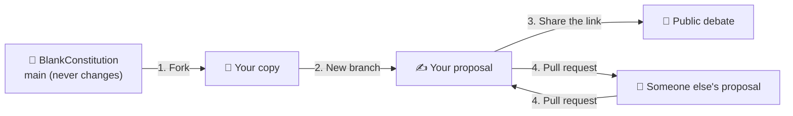

# How to take part

You don't need to be a programmer. If you can write an email, you can write your own constitution here.

← Back to the [manifesto](../README.md) · Read the [constitution](../constitution.md)

## How this project works

The original text is a starting point, and **it never changes**. We will never accept pull requests into it. The `main` branch, and its translations (such as `esp` and `ita`), stay exactly as they were first written, so that everyone always starts from the same blank page.

Your proposal lives on **your own branch**, in your own copy of the project. Nobody has to approve it. It is public from the moment you save it. If you like someone else's version, build on it, or send them your changes. We do the same: our own proposals live on our own branches, like everyone else's.

1. **Fork**: make your own copy of the project in your GitHub account.
2. **Branch**: open a branch with a name for your proposal, and edit `constitution.md` until it says what you believe.
3. **Share** the link to your branch. Anyone can read it, comment on it, or fork it.
4. **Exchange.** You can send pull requests to other people's proposals, and they can send them to yours. Each person decides what goes into their own branch.

## Pick your path

| I prefer… | Guide | Time |
|---|---|---|
| Clicking in the browser | [Using the GitHub website](web.md) | ~10 min |
| Typing commands | [Using Git in the terminal](terminal.md) | ~15 min |
| Just giving my opinion | [Open an issue](web.md#just-want-to-comment-open-an-issue) | ~2 min |

## Words you will meet

| Word | Plain meaning |
|---|---|
| **Repository** (repo) | A project folder with its whole history. This project is one. |
| **Fork** | Your personal copy of someone else's repository. |
| **Branch** | A parallel version of the text. Your proposal lives on one. |
| **Commit** | Saving a change, with a short note explaining it. Every commit is kept forever. |
| **Pull request** (PR) | "I changed this, please look at it and consider taking it." Here, only between people's proposals, never into `main`. |
| **Issue** | A public thread for a question, an idea or a disagreement. |
| **Merge** | Accepting a pull request into your own branch. |
| **Clone** | Downloading a repository to your computer (terminal path only). |

## Learn by playing

GitHub does not allow embedded web pages (iframes) inside its documents, so these open in a new tab:

- [Learn Git Branching](https://learngitbranching.js.org/): an interactive, visual game that teaches Git in your browser. Available in many languages, Spanish and Italian included.
- [GitHub Skills: Introduction to GitHub](https://github.com/skills/introduction-to-github): a guided course that runs inside GitHub itself.
- [GitHub's "Hello World"](https://docs.github.com/en/get-started/start-your-journey/hello-world): the official first steps.
