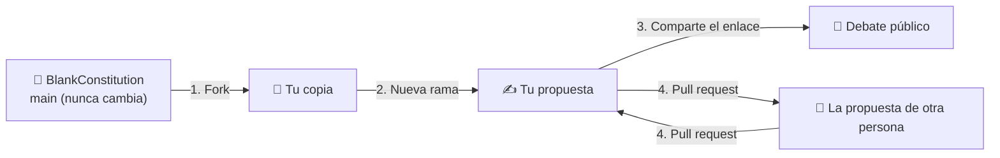

# Cómo participar

No hace falta ser programador. Si sabes escribir un correo, puedes escribir aquí tu propia constitución.

← Volver al [manifiesto](../README.md) · Leer la [constitución](../constitution.md)

## Cómo funciona este proyecto

El texto original es un punto de partida, y **nunca cambia**. Nunca aceptaremos pull requests sobre él. La rama `main`, y sus traducciones (como `esp` e `ita`), se quedan exactamente como se escribieron por primera vez, para que todo el mundo parta siempre de la misma página en blanco.

Tu propuesta vive en **tu propia rama**, en tu propia copia del proyecto. Nadie tiene que aprobarla. Es pública desde el momento en que la guardas. Si te gusta la versión de otra persona, construye sobre ella, o mándale tus cambios. Nosotros hacemos lo mismo: nuestras propias propuestas viven en nuestras propias ramas, como las de todos.

1. **Fork**: haz tu propia copia del proyecto en tu cuenta de GitHub.
2. **Rama**: abre una rama con un nombre para tu propuesta, y edita `constitution.md` hasta que diga lo que crees.
3. **Comparte** el enlace a tu rama. Cualquiera puede leerla, comentarla o hacer un fork de ella.
4. **Intercambia.** Puedes enviar pull requests a las propuestas de otras personas, y ellas a la tuya. Cada uno decide qué entra en su propia rama.

## Elige tu camino

| Prefiero… | Guía | Tiempo |
|---|---|---|
| Hacer clic en el navegador | [Usar la web de GitHub](web.md) | ~10 min |
| Escribir comandos | [Usar Git en la terminal](terminal.md) | ~15 min |
| Solo dar mi opinión | [Abrir un issue](web.md#solo-quieres-comentar-abre-un-issue) | ~2 min |

## Palabras que te vas a encontrar

| Palabra | Qué significa |
|---|---|
| **Repositorio** (repo) | Una carpeta de proyecto con toda su historia. Este proyecto es uno. |
| **Fork** | Tu copia personal del repositorio de otra persona. |
| **Rama** (branch) | Una versión paralela del texto. Tu propuesta vive en una. |
| **Commit** | Guardar un cambio, con una nota breve que lo explica. Todos los commits se conservan para siempre. |
| **Pull request** (PR) | «He cambiado esto, échale un vistazo y plantéate incorporarlo». Aquí, solo entre propuestas de personas, nunca hacia `main`. |
| **Issue** | Un hilo público para una pregunta, una idea o un desacuerdo. |
| **Merge** | Aceptar un pull request en tu propia rama. |
| **Clonar** (clone) | Descargar un repositorio a tu ordenador (solo en la terminal). |

## Aprende jugando

GitHub no permite incrustar páginas web (iframes) dentro de sus documentos, así que estos enlaces se abren en una pestaña nueva:

- [Learn Git Branching](https://learngitbranching.js.org/?locale=es_ES): un juego interactivo y visual que enseña Git en tu navegador, en español.
- [GitHub Skills: Introduction to GitHub](https://github.com/skills/introduction-to-github): un curso guiado que funciona dentro del propio GitHub (en inglés).
- [«Hola mundo» de GitHub](https://docs.github.com/es/get-started/start-your-journey/hello-world): los primeros pasos oficiales.
