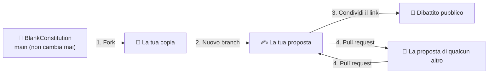

# Come partecipare

Non serve essere programmatori. Se sai scrivere un'email, puoi scrivere qui la tua costituzione.

← Torna al [manifesto](../README.md) · Leggi la [costituzione](../constitution.md)

## Come funziona questo progetto

Il testo originale è un punto di partenza, e **non cambia mai**. Non accetteremo mai pull request su di esso. Il branch `main`, e le sue traduzioni (come `esp` e `ita`), restano esattamente come sono stati scritti la prima volta, così che tutti partano sempre dalla stessa pagina bianca.

La tua proposta vive sul **tuo branch**, nella tua copia del progetto. Nessuno deve approvarla. È pubblica dal momento in cui la salvi. Se ti piace la versione di qualcun altro, costruiscici sopra, o mandagli le tue modifiche. Noi facciamo lo stesso: le nostre proposte vivono sui nostri branch, come quelle di tutti.

1. **Fork**: crea la tua copia del progetto nel tuo account GitHub.
2. **Branch**: apri un branch con un nome per la tua proposta, e modifica `constitution.md` finché non dice ciò in cui credi.
3. **Condividi** il link al tuo branch. Chiunque può leggerlo, commentarlo o farne un fork.
4. **Scambia.** Puoi inviare pull request alle proposte degli altri, e loro alla tua. Ognuno decide cosa entra nel proprio branch.

## Scegli la tua strada

| Preferisco… | Guida | Tempo |
|---|---|---|
| Cliccare nel browser | [Usare il sito di GitHub](web.md) | ~10 min |
| Scrivere comandi | [Usare Git nel terminale](terminal.md) | ~15 min |
| Solo dire la mia | [Aprire una issue](web.md#vuoi-solo-commentare-apri-una-issue) | ~2 min |

## Parole che incontrerai

| Parola | Cosa significa |
|---|---|
| **Repository** (repo) | Una cartella di progetto con tutta la sua storia. Questo progetto è uno. |
| **Fork** | La tua copia personale del repository di qualcun altro. |
| **Branch** | Una versione parallela del testo. La tua proposta vive su uno. |
| **Commit** | Salvare una modifica, con una breve nota che la spiega. Ogni commit resta per sempre. |
| **Pull request** (PR) | «Ho cambiato questo, dagli un'occhiata e valuta se accoglierlo». Qui, solo tra proposte di persone, mai verso `main`. |
| **Issue** | Un thread pubblico per una domanda, un'idea o un disaccordo. |
| **Merge** | Accettare una pull request nel tuo branch. |
| **Clone** | Scaricare un repository sul tuo computer (solo nel terminale). |

## Impara giocando

GitHub non permette di incorporare pagine web (iframe) nei suoi documenti, quindi questi link si aprono in una nuova scheda:

- [Learn Git Branching](https://learngitbranching.js.org/?locale=it_IT): un gioco interattivo e visivo che insegna Git nel tuo browser, in italiano.
- [GitHub Skills: Introduction to GitHub](https://github.com/skills/introduction-to-github): un corso guidato che funziona dentro GitHub stesso (in inglese).
- [L'«Hello World» di GitHub](https://docs.github.com/en/get-started/start-your-journey/hello-world): i primi passi ufficiali (in inglese).
