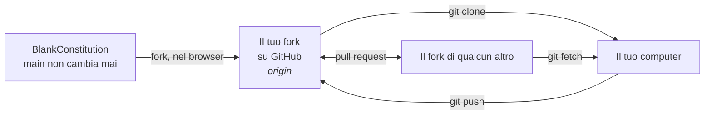
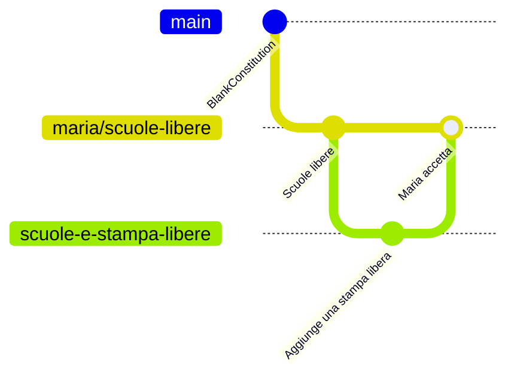

# Usare Git nel terminale

Per chi preferisce scrivere. Ogni comando è spiegato; copiali uno alla volta.

← [Tutte le guide](README.md) · [Manifesto](../README.md) · [Costituzione](../constitution.md)

## Come si incastrano i pezzi



L'originale non cambia mai e non accetta pull request. La tua proposta vive su un branch del tuo fork.

## 0. Installa Git (una volta)

<details>
<summary><b>Windows</b></summary>

Scarica e installa [Git for Windows](https://git-scm.com/downloads). Lascia le opzioni predefinite. Poi apri **Git Bash** dal menu Start.
</details>

<details>
<summary><b>macOS</b></summary>

Apri **Terminale** e scrivi `git --version`. Se Git manca, macOS ti proporrà di installarlo.
</details>

<details>
<summary><b>Linux</b></summary>

`sudo apt install git` (Debian/Ubuntu) o `sudo dnf install git` (Fedora).
</details>

Di' a Git chi sei. Questo nome firma i tuoi commit:

```bash
git config --global user.name "Il Tuo Nome"
git config --global user.email "tu@esempio.it"
```

## 1. Fai un fork e scaricalo

Prima fai un fork del progetto su GitHub (vedi il [passo 1 della guida web](web.md#1-fai-un-fork-del-progetto)). Poi:

```bash
git clone https://github.com/TUO-NOME/blankconstitution.git   # scarica il tuo fork
cd blankconstitution                                          # entra nella cartella
```

## 2. Apri un branch per la tua proposta

```bash
git switch ita                         # il testo in italiano
git switch -c scuole-libere      # crea il tuo branch da lì e passaci sopra
```

Apri `constitution.md` con qualsiasi editor di testo, fai le tue modifiche e salva il file. Lascia `main` e `ita` come sono: sono la tua copia della pagina bianca.

## 3. Fai commit e caricalo

```bash
git status                             # cosa è cambiato?
git diff                               # mostrami esattamente cosa è cambiato
git add constitution.md                # includi questo file nel prossimo commit
git commit -m "Aggiunge l'Articolo XIII sull'istruzione"
git push -u origin scuole-libere # carica il tuo branch sul tuo fork
```

La tua proposta è ora pubblica su `github.com/TUO-NOME/blankconstitution/tree/scuole-libere`. Condividi quel link.

> Git potrebbe mostrarti un link per aprire una pull request. Non aprirne una verso BlankConstitution: non sarà accettata. Il tuo branch è già la tua proposta.

## 4. Costruisci sulla proposta di qualcun altro

```bash
git remote add maria https://github.com/maria/blankconstitution.git   # ricorda il suo fork
git fetch maria                                                       # scarica i suoi branch
git switch -c scuole-e-stampa-libere maria/scuole-libere           # il tuo branch, a partire dal suo
```

Modifica, fai commit e carica come al passo 3. Per prendere le sue modifiche successive:

```bash
git pull maria scuole-libere
```

Per mandarle le tue modifiche, carica il tuo branch e apri una pull request da esso verso il suo su GitHub (vedi [la guida web](web.md#lavorare-con-le-proposte-degli-altri)). Decide lei se fare il merge.

## Cosa è appena successo



`main` non si muove mai. Ogni proposta cresce accanto a esso, e le proposte prendono in prestito idee l'una dall'altra.

## Promemoria

| Comando | Cosa fa |
|---|---|
| `git status` | Mostra cosa hai cambiato |
| `git diff` | Mostra le modifiche riga per riga |
| `git add FILE` | Sceglie un file per il prossimo commit |
| `git commit -m "…"` | Salva le modifiche scelte con una nota |
| `git push` | Carica i tuoi commit su GitHub |
| `git switch -c NOME` | Inizia un nuovo branch |
| `git remote add NOME URL` | Ricorda il fork di qualcun altro |
| `git fetch NOME` | Scarica i suoi branch |
| `git log --oneline` | Elenca i commit passati |

Bloccato? [Learn Git Branching](https://learngitbranching.js.org/?locale=it_IT) insegna tutto questo in modo visivo, nel tuo browser. Oppure torna alla [guida web](web.md): puoi sempre farlo con i clic.
