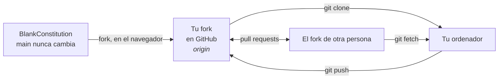
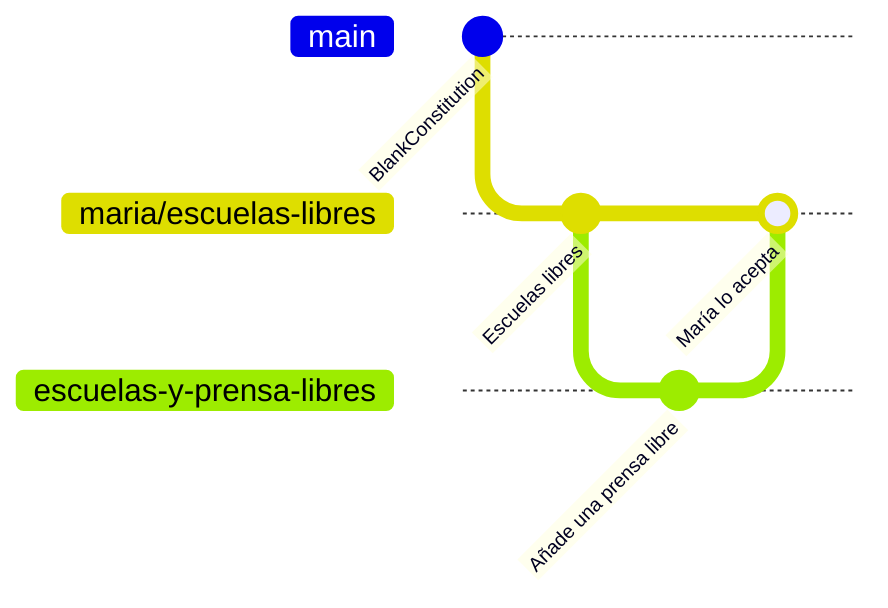

# Usar Git en la terminal

Para quienes prefieren escribir. Cada comando está explicado; cópialos de uno en uno.

← [Todas las guías](README.md) · [Manifiesto](../README.md) · [Constitución](../constitution.md)

## Cómo encajan las piezas



El original nunca cambia y no acepta pull requests. Tu propuesta vive en una rama de tu propio fork.

## 0. Instala Git (una vez)

<details>
<summary><b>Windows</b></summary>

Descarga e instala [Git for Windows](https://git-scm.com/downloads). Deja las opciones por defecto. Después abre **Git Bash** desde el menú Inicio.
</details>

<details>
<summary><b>macOS</b></summary>

Abre **Terminal** y escribe `git --version`. Si falta Git, macOS te ofrecerá instalarlo.
</details>

<details>
<summary><b>Linux</b></summary>

`sudo apt install git` (Debian/Ubuntu) o `sudo dnf install git` (Fedora).
</details>

Dile a Git quién eres. Este nombre firma tus commits:

```bash
git config --global user.name "Tu Nombre"
git config --global user.email "tu@ejemplo.com"
```

## 1. Haz un fork y descárgalo

Primero haz un fork del proyecto en GitHub (mira el [paso 1 de la guía web](web.md#1-haz-un-fork-del-proyecto)). Después:

```bash
git clone https://github.com/TU-NOMBRE/blankconstitution.git   # descarga tu fork
cd blankconstitution                                           # entra en la carpeta
```

## 2. Abre una rama para tu propuesta

```bash
git switch esp                       # el texto en español
git switch -c escuelas-libres      # crea tu rama a partir de él y entra en ella
```

Abre `constitution.md` con cualquier editor de texto, haz tus cambios y guarda el archivo. Deja `main` y `esp` como están: son tu copia de la página en blanco.

## 3. Haz commit y súbelo

```bash
git status                           # ¿qué ha cambiado?
git diff                             # enséñame exactamente qué ha cambiado
git add constitution.md              # incluye este archivo en el próximo commit
git commit -m "Añade el Artículo XIII sobre educación"
git push -u origin escuelas-libres # sube tu rama a tu fork
```

Tu propuesta ya es pública en `github.com/TU-NOMBRE/blankconstitution/tree/escuelas-libres`. Comparte ese enlace.

> Puede que Git te muestre un enlace para abrir un pull request. No abras uno hacia BlankConstitution: no se aceptará. Tu rama ya es tu propuesta.

## 4. Construye sobre la propuesta de otra persona

```bash
git remote add maria https://github.com/maria/blankconstitution.git   # recuerda su fork
git fetch maria                                                       # descarga sus ramas
git switch -c escuelas-y-prensa-libres maria/escuelas-libres              # tu rama, a partir de la suya
```

Edita, haz commit y súbelo como en el paso 3. Para recoger sus cambios posteriores:

```bash
git pull maria escuelas-libres
```

Para enviarle tus cambios, sube tu rama y abre un pull request desde ella hacia la suya en GitHub (mira [la guía web](web.md#trabajar-con-las-propuestas-de-otras-personas)). Ella decide si lo fusiona.

## Qué acaba de pasar



`main` nunca se mueve. Cada propuesta crece a su lado, y las propuestas se toman prestadas ideas unas a otras.

## Chuleta

| Comando | Qué hace |
|---|---|
| `git status` | Muestra lo que has cambiado |
| `git diff` | Muestra los cambios línea a línea |
| `git add ARCHIVO` | Elige un archivo para el próximo commit |
| `git commit -m "…"` | Guarda los cambios elegidos con una nota |
| `git push` | Sube tus commits a GitHub |
| `git switch -c NOMBRE` | Empieza una rama nueva |
| `git remote add NOMBRE URL` | Recuerda el fork de otra persona |
| `git fetch NOMBRE` | Descarga sus ramas |
| `git log --oneline` | Lista los commits anteriores |

¿Atascado? [Learn Git Branching](https://learngitbranching.js.org/?locale=es_ES) enseña todo esto de forma visual, en tu navegador. O vuelve a la [guía web](web.md): siempre puedes hacerlo con clics.
