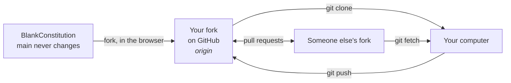
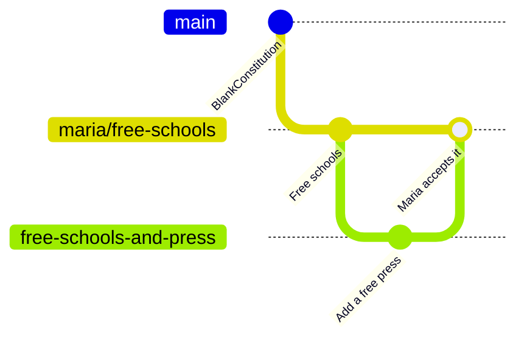

# Using Git in the terminal

For those who like to type. Every command is explained; copy them one at a time.

← [All guides](README.md) · [Manifesto](../README.md) · [Constitution](../constitution.md)

## How the pieces fit



The original is never changed and accepts no pull requests. Your proposal lives on a branch of your own fork.

## 0. Install Git (once)

<details>
<summary><b>Windows</b></summary>

Download and install [Git for Windows](https://git-scm.com/downloads). Keep the default options. Then open **Git Bash** from the Start menu.
</details>

<details>
<summary><b>macOS</b></summary>

Open **Terminal** and type `git --version`. If Git is missing, macOS will offer to install it.
</details>

<details>
<summary><b>Linux</b></summary>

`sudo apt install git` (Debian/Ubuntu) or `sudo dnf install git` (Fedora).
</details>

Tell Git who you are. This name signs your commits:

```bash
git config --global user.name "Your Name"
git config --global user.email "you@example.com"
```

## 1. Fork and download

Fork the project on GitHub first (see [step 1 of the web guide](web.md#1-fork-the-project)). Then:

```bash
git clone https://github.com/YOUR-NAME/blankconstitution.git   # download your fork
cd blankconstitution                                           # step into the folder
```

## 2. Open a branch for your proposal

```bash
git switch -c free-schools      # create your branch and move onto it
```

Open `constitution.md` in any text editor, make your changes, save the file. Leave `main` as it is: it is your copy of the blank page.

## 3. Commit and push

```bash
git status                          # what changed?
git diff                            # show me exactly what changed
git add constitution.md             # include this file in the next commit
git commit -m "Add Article XIII on education"
git push -u origin free-schools # upload your branch to your fork
```

Your proposal is now public at `github.com/YOUR-NAME/blankconstitution/tree/free-schools`. Share that link.

> Git may print a link offering to open a pull request. Don't open one into BlankConstitution: it will not be accepted. Your branch is already your proposal.

## 4. Build on someone else's proposal

```bash
git remote add maria https://github.com/maria/blankconstitution.git   # remember her fork
git fetch maria                                                       # download her branches
git switch -c free-schools-and-press maria/free-schools              # your branch, starting from hers
```

Edit, commit and push as in step 3. To pick up her later changes:

```bash
git pull maria free-schools
```

To send her your changes, push your branch and open a pull request from it to her branch on GitHub (see [the web guide](web.md#working-with-other-peoples-proposals)). She decides whether to merge it.

## What just happened



`main` never moves. Every proposal grows beside it, and proposals borrow from each other.

## Cheat sheet

| Command | What it does |
|---|---|
| `git status` | Shows what you have changed |
| `git diff` | Shows the changes line by line |
| `git add FILE` | Picks a file for the next commit |
| `git commit -m "…"` | Saves the picked changes with a note |
| `git push` | Uploads your commits to GitHub |
| `git switch -c NAME` | Starts a new branch |
| `git remote add NAME URL` | Remembers someone else's fork |
| `git fetch NAME` | Downloads their branches |
| `git log --oneline` | Lists past commits |

Stuck? [Learn Git Branching](https://learngitbranching.js.org/) teaches all of this visually, in your browser. Or go back to the [web guide](web.md): you can always do it with clicks instead.
