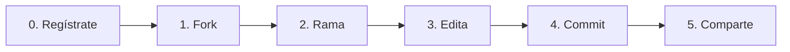
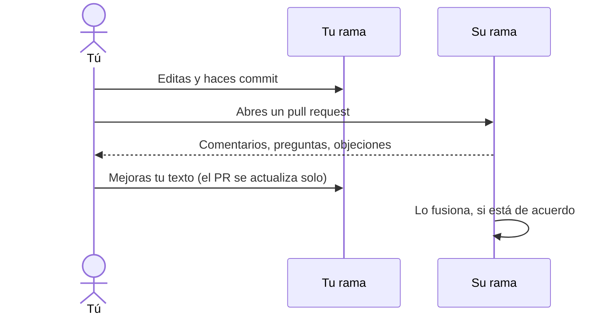

# Usar la web de GitHub

Sin instalar nada. Todo ocurre en tu navegador.

← [Todas las guías](README.md) · [Manifiesto](../README.md) · [Constitución](../constitution.md)

> Los botones de GitHub aparecen en inglés. Aquí los escribimos tal cual, en **negrita**, para que los reconozcas.



## 0. Crea una cuenta

Entra en [github.com/signup](https://github.com/signup) y sigue los pasos. Es gratis. Elige un nombre de usuario con el que te parezca bien firmar propuestas.

## 1. Haz un fork del proyecto

Abre el [repositorio de BlankConstitution](https://github.com/BlankConstitution/blankconstitution). En la esquina superior derecha, haz clic en **Fork**.

```
┌──────────────────────────────────────────────────────────────────────┐
│ BlankConstitution / blankconstitution          👁 Watch  🍴 Fork ⭐ Star│
│                                                         ▲            │
│ <> Code   ⊙ Issues   ⇄ Pull requests            haz clic aquí        │
└──────────────────────────────────────────────────────────────────────┘
```

En la siguiente pantalla, desmarca **Copy the `main` branch only** si quieres también las traducciones, y haz clic en **Create fork**. Ya tienes tu propia copia en `github.com/TU-NOMBRE/blankconstitution`.

## 2. Abre una rama para tu propuesta

En **tu fork**, haz clic en el botón de ramas (pone `main`; elige `esp` si quieres partir del texto en español), escribe un nombre para tu propuesta y haz clic en **Create branch**.

```
┌──────────────────────────────────────────────┐
│ [ ⑂ esp ▾ ]                                  │
│ ┌──────────────────────────────────────────┐ │
│ │ Switch branches/tags                     │ │
│ │ ┌──────────────────────────────────────┐ │ │
│ │ │ escuelas-libres                      │ │ │  ← nombra tu propuesta
│ │ └──────────────────────────────────────┘ │ │
│ │ ⑂ Create branch: escuelas-libres         │ │  ← clic
│ └──────────────────────────────────────────┘ │
└──────────────────────────────────────────────┘
```

Tu propuesta vivirá aquí. Deja `main` y `esp` como están: son tu copia de la página en blanco.

## 3. Edita la constitución

Asegúrate de que el botón de ramas muestra **tu rama**. Haz clic en `constitution.md` y luego en el icono del **lápiz** ✏️, arriba a la derecha del archivo.

```
┌──────────────────────────────────────────────────────────────────────┐
│ [ ⑂ escuelas-libres ▾ ]  blankconstitution / constitution.md       │
│ ┌──────────────┐                                    Raw  ⧉  ⬇  ✏️  ⋯ │
│ │Preview │ Code│                                               ▲     │
│ └──────────────┘                                    editar el archivo│
└──────────────────────────────────────────────────────────────────────┘
```

Escribe como en cualquier cuadro de texto. Unas pocas marcas dan forma al texto:

| Escribes | Obtienes |
|---|---|
| `## Artículo XIII. De la educación` | Un título |
| `1. Las escuelas…` | Una cláusula numerada |
| `**debe**` | **negrita** |
| `*puede*` | *cursiva* |

Usa la pestaña **Preview** para ver cómo quedará.

## 4. Guarda tu cambio (commit)

Haz clic en el botón verde **Commit changes…**. Aparece un cuadro:

```
┌─ Commit changes ─────────────────────────────────────┐
│ Commit message                                       │
│ ┌──────────────────────────────────────────────────┐ │
│ │ Añade el Artículo XIII sobre educación           │ │  ← título breve y claro
│ └──────────────────────────────────────────────────┘ │
│ Extended description                                 │
│ ┌──────────────────────────────────────────────────┐ │
│ │ Las escuelas deberían estar libres de ideología… │ │  ← por qué (opcional)
│ └──────────────────────────────────────────────────┘ │
│ ◉ Commit directly to the escuelas-libres branch      │
│                              [ Commit changes ]      │
└──────────────────────────────────────────────────────┘
```

Haz clic en **Commit changes**. Listo: tu rama ya contiene tu versión, y cualquiera puede leerla.

## 5. Compártela

Copia la dirección de tu navegador. Se parece a `github.com/TU-NOMBRE/blankconstitution/tree/escuelas-libres`. Envíala, publícala o anúnciala en un [issue](#solo-quieres-comentar-abre-un-issue) del original para que otros la encuentren.

> **El original nunca acepta pull requests.** GitHub a veces muestra un botón **Contribute** que ofrece abrir uno hacia BlankConstitution. Ignóralo. Tu rama ya es tu propuesta.

## Trabajar con las propuestas de otras personas

**Construir sobre la propuesta de alguien.** Abre su fork, cambia a su rama y haz clic en **Fork**. Desmarca **Copy the `main` branch only** para que su rama venga incluida. Luego abre tu propia rama a partir de la suya, como en el paso 2.

**Enviarle tus cambios.** Abre un pull request desde tu rama hacia la suya:

1. En tu fork, haz clic en **Pull requests → New pull request**.
2. Haz clic en **compare across forks**.
3. A la izquierda (**base**), elige *su* fork y su rama. A la derecha (**head**), elige *los tuyos*.
4. Haz clic en **Create pull request** y explica tus razones.



Los demás pueden hacer lo mismo con la tuya. Los pull requests que te envíen aparecen en **Pull requests** de tu fork, y tú decides si los fusionas.

## ¿Solo quieres comentar? Abre un issue

1. Ve a la [pestaña Issues](https://github.com/BlankConstitution/blankconstitution/issues) del original.
2. Haz clic en **New issue**.
3. Ponle un título («Artículo V: ¿por qué solo dos mandatos?») y escribe tu argumento.
4. Haz clic en **Submit new issue**.

También puedes comentar cualquier línea de un pull request abierto: abre el PR, ve a **Files changed** y haz clic en el **+** que aparece junto a la línea.

## ¿Prefieres una aplicación?

[GitHub Desktop](https://desktop.github.com/) hace todo esto con botones, en Windows y macOS, y te deja editar los archivos con el editor de texto que prefieras.

¿Te manejas con comandos? Mira la [guía de la terminal](terminal.md).
