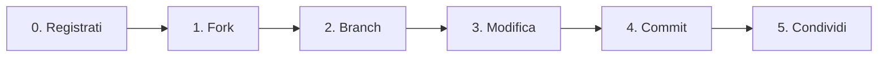
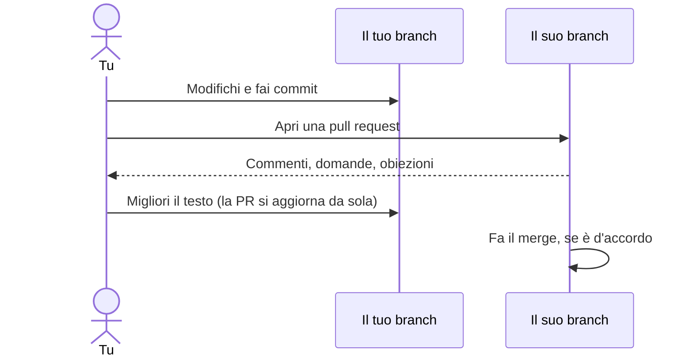

# Usare il sito di GitHub

Niente da installare. Tutto succede nel tuo browser.

← [Tutte le guide](README.md) · [Manifesto](../README.md) · [Costituzione](../constitution.md)

> I pulsanti di GitHub sono in inglese. Qui li scriviamo così come sono, in **grassetto**, perché tu li riconosca.



## 0. Crea un account

Vai su [github.com/signup](https://github.com/signup) e segui i passaggi. È gratis. Scegli un nome utente con cui ti va bene firmare le proposte.

## 1. Fai un fork del progetto

Apri il [repository di BlankConstitution](https://github.com/BlankConstitution/blankconstitution). In alto a destra, clicca **Fork**.

```
┌──────────────────────────────────────────────────────────────────────┐
│ BlankConstitution / blankconstitution          👁 Watch  🍴 Fork ⭐ Star│
│                                                         ▲            │
│ <> Code   ⊙ Issues   ⇄ Pull requests            clicca qui           │
└──────────────────────────────────────────────────────────────────────┘
```

Nella schermata successiva, togli la spunta da **Copy the `main` branch only** se vuoi anche le traduzioni, e clicca **Create fork**. Ora hai la tua copia su `github.com/TUO-NOME/blankconstitution`.

## 2. Apri un branch per la tua proposta

Nel **tuo fork**, clicca il pulsante dei branch (dice `main`; scegli `ita` se vuoi partire dal testo in italiano), scrivi un nome per la tua proposta e clicca **Create branch**.

```
┌──────────────────────────────────────────────┐
│ [ ⑂ ita ▾ ]                                  │
│ ┌──────────────────────────────────────────┐ │
│ │ Switch branches/tags                     │ │
│ │ ┌──────────────────────────────────────┐ │ │
│ │ │ scuole-libere                        │ │ │  ← dai un nome alla proposta
│ │ └──────────────────────────────────────┘ │ │
│ │ ⑂ Create branch: scuole-libere           │ │  ← clicca
│ └──────────────────────────────────────────┘ │
└──────────────────────────────────────────────┘
```

La tua proposta vivrà qui. Lascia `main` e `ita` come sono: sono la tua copia della pagina bianca.

## 3. Modifica la costituzione

Assicurati che il pulsante dei branch mostri **il tuo branch**. Clicca `constitution.md`, poi l'icona della **matita** ✏️ in alto a destra del file.

```
┌──────────────────────────────────────────────────────────────────────┐
│ [ ⑂ scuole-libere ▾ ]  blankconstitution / constitution.md     │
│ ┌──────────────┐                                    Raw  ⧉  ⬇  ✏️  ⋯ │
│ │Preview │ Code│                                               ▲     │
│ └──────────────┘                                    modifica il file │
└──────────────────────────────────────────────────────────────────────┘
```

Scrivi come in qualsiasi casella di testo. Pochi segni danno forma al testo:

| Scrivi | Ottieni |
|---|---|
| `## Articolo XIII. Dell'istruzione` | Un titolo |
| `1. Le scuole…` | Una clausola numerata |
| `**deve**` | **grassetto** |
| `*può*` | *corsivo* |

Usa la scheda **Preview** per vedere come apparirà.

## 4. Salva la modifica (commit)

Clicca il pulsante verde **Commit changes…**. Compare un riquadro:

```
┌─ Commit changes ─────────────────────────────────────┐
│ Commit message                                       │
│ ┌──────────────────────────────────────────────────┐ │
│ │ Aggiunge l'Articolo XIII sull'istruzione         │ │  ← titolo breve e chiaro
│ └──────────────────────────────────────────────────┘ │
│ Extended description                                 │
│ ┌──────────────────────────────────────────────────┐ │
│ │ Le scuole dovrebbero essere libere da ideologie… │ │  ← perché (facoltativo)
│ └──────────────────────────────────────────────────┘ │
│ ◉ Commit directly to the scuole-libere branch        │
│                              [ Commit changes ]      │
└──────────────────────────────────────────────────────┘
```

Clicca **Commit changes**. Fatto: il tuo branch ora contiene la tua versione, e chiunque può leggerla.

## 5. Condividila

Copia l'indirizzo dal browser. Somiglia a `github.com/TUO-NOME/blankconstitution/tree/scuole-libere`. Mandalo, pubblicalo o annuncialo in una [issue](#vuoi-solo-commentare-apri-una-issue) dell'originale, così che altri possano trovarlo.

> **L'originale non accetta mai pull request.** A volte GitHub mostra un pulsante **Contribute** che propone di aprirne una verso BlankConstitution. Ignoralo. Il tuo branch è già la tua proposta.

## Lavorare con le proposte degli altri

**Costruire sulla proposta di qualcuno.** Apri il suo fork, passa al suo branch e clicca **Fork**. Togli la spunta da **Copy the `main` branch only** così che il suo branch venga incluso. Poi apri il tuo branch a partire dal suo, come al passo 2.

**Mandargli le tue modifiche.** Apri una pull request dal tuo branch verso il suo:

1. Nel tuo fork, clicca **Pull requests → New pull request**.
2. Clicca **compare across forks**.
3. A sinistra (**base**), scegli il *suo* fork e il suo branch. A destra (**head**), scegli *i tuoi*.
4. Clicca **Create pull request** e spiega le tue ragioni.



Gli altri possono fare lo stesso con la tua. Le pull request che ti inviano compaiono in **Pull requests** nel tuo fork, e decidi tu se fare il merge.

## Vuoi solo commentare? Apri una issue

1. Vai alla [scheda Issues](https://github.com/BlankConstitution/blankconstitution/issues) dell'originale.
2. Clicca **New issue**.
3. Dai un titolo («Articolo V: perché solo due mandati?») e scrivi il tuo argomento.
4. Clicca **Submit new issue**.

Puoi anche commentare qualsiasi riga di una pull request aperta: apri la PR, vai su **Files changed** e clicca il **+** che compare accanto alla riga.

## Preferisci un'app?

[GitHub Desktop](https://desktop.github.com/) fa tutto questo con dei pulsanti, su Windows e macOS, e ti permette di modificare i file con l'editor di testo che preferisci.

Te la cavi con i comandi? Guarda la [guida al terminale](terminal.md).
