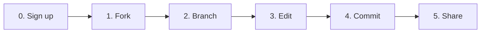
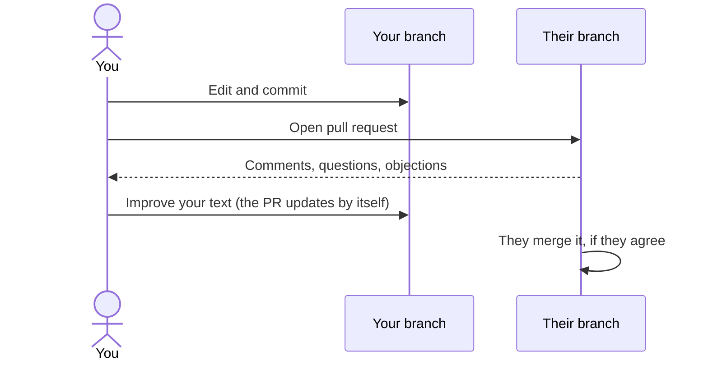

# Using the GitHub website

No installation. Everything happens in your browser.

← [All guides](README.md) · [Manifesto](../README.md) · [Constitution](../constitution.md)



## 0. Create an account

Go to [github.com/signup](https://github.com/signup) and follow the steps. It's free. Pick a username you are happy to sign proposals with.

## 1. Fork the project

Open the [BlankConstitution repository](https://github.com/BlankConstitution/blankconstitution). In the top-right corner, click **Fork**.

```
┌──────────────────────────────────────────────────────────────────────┐
│ BlankConstitution / blankconstitution          👁 Watch  🍴 Fork ⭐ Star│
│                                                         ▲            │
│ <> Code   ⊙ Issues   ⇄ Pull requests            click here           │
└──────────────────────────────────────────────────────────────────────┘
```

On the next screen, untick **Copy the `main` branch only** if you also want the translations (`esp`, `ita`), and click **Create fork**. You now have your own copy at `github.com/YOUR-NAME/blankconstitution`.

## 2. Open a branch for your proposal

In **your fork**, click the branch button (it says `main`), type a name for your proposal, and click **Create branch**.

```
┌──────────────────────────────────────────────┐
│ [ ⑂ main ▾ ]                                 │
│ ┌──────────────────────────────────────────┐ │
│ │ Switch branches/tags                     │ │
│ │ ┌──────────────────────────────────────┐ │ │
│ │ │ free-schools                         │ │ │  ← name your proposal
│ │ └──────────────────────────────────────┘ │ │
│ │ ⑂ Create branch: free-schools            │ │  ← click
│ └──────────────────────────────────────────┘ │
└──────────────────────────────────────────────┘
```

Your proposal will live here. Leave `main` as it is: it is your copy of the blank page.

## 3. Edit the constitution

Make sure the branch button shows **your branch**. Click `constitution.md`, then the **pencil** icon ✏️ at the top right of the file.

```
┌──────────────────────────────────────────────────────────────────────┐
│ [ ⑂ free-schools ▾ ]  blankconstitution / constitution.md       │
│ ┌──────────────┐                                    Raw  ⧉  ⬇  ✏️  ⋯ │
│ │Preview │ Code│                                               ▲     │
│ └──────────────┘                                     edit this file  │
└──────────────────────────────────────────────────────────────────────┘
```

Write as you would in any text box. A few marks give the text its shape:

| You type | You get |
|---|---|
| `## Article XIII. Of Education` | A heading |
| `1. Schools shall…` | A numbered clause |
| `**must**` | **bold** |
| `*may*` | *italic* |

Use the **Preview** tab to see how it will look.

## 4. Save your change (commit)

Click the green **Commit changes…** button. A box appears:

```
┌─ Commit changes ─────────────────────────────────────┐
│ Commit message                                       │
│ ┌──────────────────────────────────────────────────┐ │
│ │ Add Article XIII on education                    │ │  ← short, clear title
│ └──────────────────────────────────────────────────┘ │
│ Extended description                                 │
│ ┌──────────────────────────────────────────────────┐ │
│ │ Schools should be free of party ideology…        │ │  ← why (optional)
│ └──────────────────────────────────────────────────┘ │
│ ◉ Commit directly to the free-schools branch         │
│                              [ Commit changes ]      │
└──────────────────────────────────────────────────────┘
```

Click **Commit changes**. Done: your branch now holds your version, and anyone can read it.

## 5. Share it

Copy the address from your browser. It looks like `github.com/YOUR-NAME/blankconstitution/tree/free-schools`. Send it, post it, or announce it in an [issue](#just-want-to-comment-open-an-issue) of the original so others can find it.

> **The original never accepts pull requests.** GitHub will sometimes show a **Contribute** button offering to open one into BlankConstitution. Ignore it. Your branch is already your proposal.

## Working with other people's proposals

**Build on someone's proposal.** Open their fork, switch to their branch, and click **Fork**. Untick *Copy the `main` branch only* so their branch comes with it. Then open your own branch from theirs, as in step 2.

**Send them your changes.** Open a pull request from your branch to theirs:

1. In your fork, click **Pull requests → New pull request**.
2. Click **compare across forks**.
3. On the left (**base**), choose *their* fork and branch. On the right (**head**), choose *yours*.
4. Click **Create pull request** and explain your reasoning.



Others can do the same with yours. Pull requests sent to you appear under **Pull requests** in your fork, and you decide whether to merge them.

## Just want to comment? Open an issue

1. Go to the [Issues tab](https://github.com/BlankConstitution/blankconstitution/issues) of the original.
2. Click **New issue**.
3. Give it a title ("Article V: why only two terms?") and write your argument.
4. Click **Submit new issue**.

You can also comment on any line of an open pull request: open the PR, go to **Files changed**, and click the **+** that appears next to a line.

## Prefer an app?

[GitHub Desktop](https://desktop.github.com/) does all of this with buttons, on Windows and macOS, and lets you edit the files with any text editor you like.

Comfortable with commands? See the [terminal guide](terminal.md).
